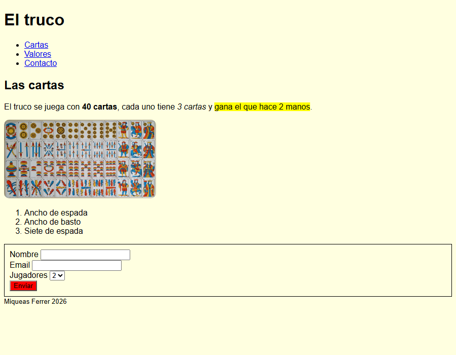

# El truco: mi primera página web

Página web sobre el truco, el juego de cartas. Está hecha con HTML semántico y una hoja de estilos CSS externa con variables. Tiene un menú de navegación, un artículo sobre las cartas del truco, una lista con las tres cartas más fuertes y un formulario para anotarse a jugar.

## Cómo abrir la página

1. Clonar el repositorio:

   ```bash
   git clone https://github.com/miqueasferrer2-ai/mi-pagina-truco.git
   ```

2. Entrar a la carpeta `mi-pagina-truco`.
3. Abrir el archivo `index.html` con cualquier navegador (doble clic o clic derecho → Abrir con).

## Estructura

```
mi-pagina-truco/
├── index.html
├── css/
│   └── estilos.css
├── capturas/
│   └── pagina.png
└── README.md
```

La imagen se carga desde una URL externa (Wikimedia Commons), por eso no hay carpeta de imágenes.

## Captura de pantalla



## Autor

- **Estudiante:** Miqueas Ferrer
- **Curso:** 4.º año, Informática
- **Unidad:** Antes de React, Módulo 1, Unidad 1: "Mi primera página web semántica y estilizada"

## Fuentes

### Bibliografía

- Duckett, J. *HTML & CSS: Design and Build Websites*. 1.ª ed. Estados Unidos: John Wiley & Sons; 2011.
- Keith, J. *HTML5 for Web Designers*. 2.ª ed. Nueva York, Estados Unidos: A Book Apart; 2010.
- MDN Web Docs. (s.f.-a). *HTML: HyperText Markup Language*. Mozilla Corporation. https://developer.mozilla.org/en-US/docs/Web/HTML
- MDN Web Docs. (s.f.-b). *CSS: Cascading Style Sheets*. Mozilla Corporation. https://developer.mozilla.org/en-US/docs/Web/CSS
- WHATWG. (2025). *HTML Living Standard*. https://html.spec.whatwg.org/

### Créditos de la imagen

- "Spanish National pattern", por Countakeshi. Wikimedia Commons, licencia [CC BY-SA 4.0](https://creativecommons.org/licenses/by-sa/4.0/). https://commons.wikimedia.org/wiki/File:Spanish_National_pattern.png
